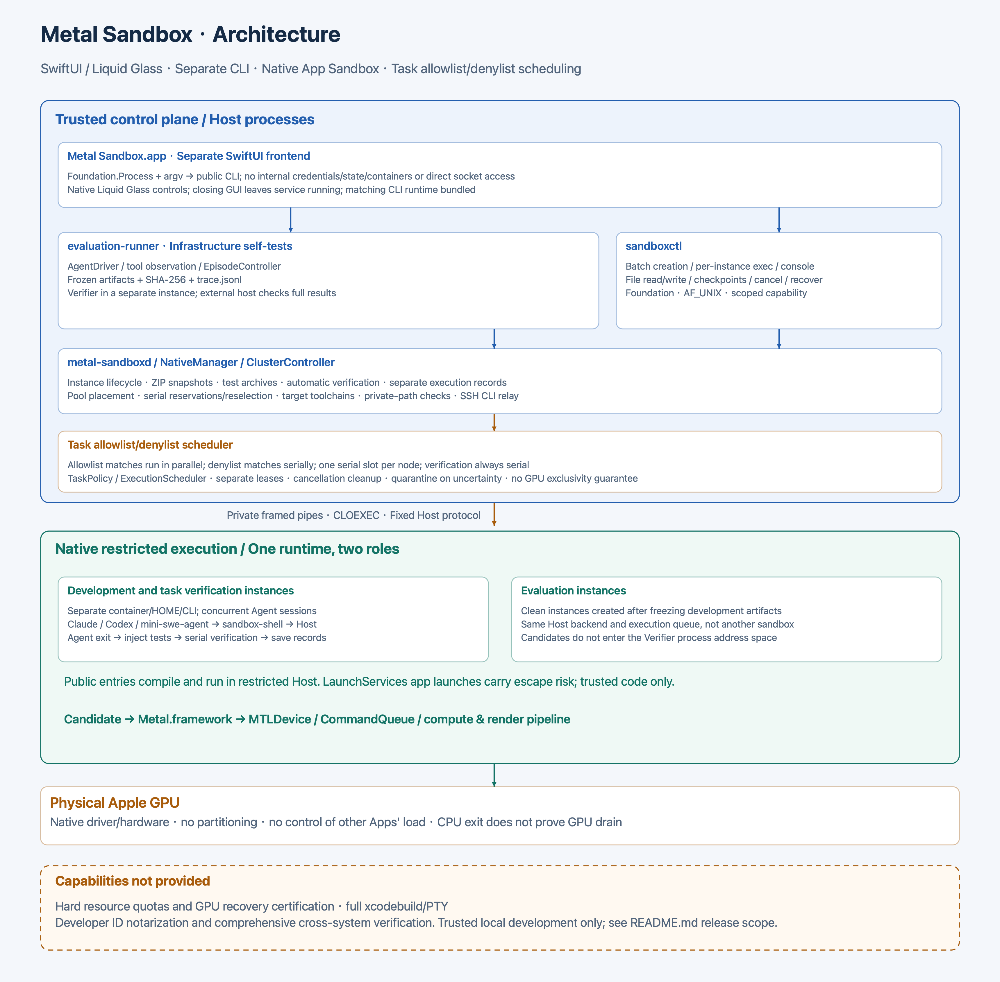

# Architecture

See the [runtime flow diagram](runtime_flow.png) for the sequence of instance creation, Agent tools, parallel and serial scheduling, verification, and snapshots.

On task import, `agent/` is copied into the workspace, and `tests/` is stored separately by its content SHA-256. With automatic verification enabled, each `exec --session` records the test version and timeout for that session. After the Agent and its related tasks finish and cleanup is confirmed, tests are installed in the same instance and executed through the execution node's serial queue. Reads remain available during verification; other execution and file modifications are blocked. Agent and verifier executions have separate records, and metrics are archived by verification execution ID. Explicit cancellation or stopping cancels subsequent verification. Service restart resumes verification that has not been submitted and does not resubmit an execution already started.

Development and evaluation use **the same runtime type with separate instances and lifecycles**. The fixed test AgentDriver runs in the trusted control plane. Agent sessions, shell adapters, and candidate commands are launched by the restricted Host. LaunchServices application launches have a reported escape risk; see the security boundary. Do not expose unrestricted host shell access or administrator tokens to an Agent.

## Modules and dependencies

| Module | Implementation | Main dependencies and APIs |
|---|---|---|
| Desktop frontend | `frontend/sources/frontend_app` | SwiftUI, AppKit; NavigationSplitView, native toolbar/sheets, macOS 26+ glassProminent |
| CLI adapter | `frontend/sources/frontend_core` | Foundation.Process, argument arrays, JSONDecoder; no backend module dependency |
| Management service and CLI | `sources/sandbox_daemon`, `sandbox_cli` | Foundation, Darwin; AF_UNIX, getpeereid, DispatchQueue |
| Instances, checkpoints, and publication | `sources/sandbox_management` | SandboxRuntime; SHA-256, atomic JSON writes |
| Automatic verification and test archives | `sources/sandbox_management/native_manager.swift`, `sandbox_runtime/verification.swift`, `task_package.swift` | Execution records, CryptoKit SHA-256, ZIPFoundation, instance operation locks; frontend calls the CLI only |
| Execution scheduling | `sources/sandbox_runtime/execution_scheduler.swift`, `task_policy.swift` | Exact path and argument allowlists/denylists, static compound-shell classification, direct parallel execution, FIFO serial slot, file locks, separate lease journal |
| Node cluster | `sources/sandbox_management/cluster_controller.swift`, `cluster_placement.swift`, `sandbox_runtime/cluster_transport.swift`, `cluster_environment.swift` | Public CLI relay over SSH, pool-aware placement by active instance count, scheduling switches on both nodes, shared workspaces, reservation and handoff of serial tasks within a pool, target toolchain resolution and private-path checks |
| Harness adapters | `sources/sandbox_runtime/agent_harness.swift`, `claude_harness.swift`, `codex_harness.swift`; `examples/harnesses/mini_swe_agent_metal.py` | Claude and Codex: native adapters, hooks, session log discovery; mini-swe-agent: Python shell environment |
| Shared shell bridge | `sources/sandbox_shell`, `sandbox_runtime/shell_bridge.swift` | Original command classification, private TMPDIR Unix socket, Host pipe, original cwd and environment |
| Bundle factory | `sources/sandbox_runtime/app_factory.swift` | `/usr/bin/codesign`, Security.framework signature and entitlement validation |
| Host, IPC, and file channel | `sources/sandbox_host`, `sandbox_runtime` | App Sandbox entitlements, pipes, CLOEXEC, openat, directory file descriptors |
| Development directories and tools | `sources/sandbox_runtime/development_policy.swift` | URL security-scoped bookmarks, fixed executable/directory exceptions, resolved tool PATH and SDKROOT |
| Child process lifecycle | `sources/sandbox_core/process_runner.swift` | posix_spawn, process groups, waitpid, signals, polling limits |
| Agent and verifier | `sources/evaluation_core`, `evaluation_runner` | AgentDriver, SandboxSession, content-addressed ArtifactStore |
| GPU examples | `sources/metal_runner` | Metal.framework; MTLDevice, CommandQueue, pipelines, buffers, textures |

The runtime does not require containers, VMs, separate user accounts, or Linux. There is no Build Broker or Build Worker. Toolchain path adaptation enables compilation directly inside App Sandbox; the controller resolves tool paths and publishes bundles with fixed signatures.

Outbound networking is selected at creation: public CLI `create` enables it and `create --no_network` disables it. The manager fixes this instance setting in the Host's `network.client` entitlement. New instances enable networking by default; no live switching interface is provided. Preparation scripts can download and install CLIs in their own HOME. `PATH` includes the instance's `.local/bin`, without including the corresponding host directory. This is a general environment facility; the runtime does not embed Claude installation logic.

The desktop frontend bundles matching CLI/runtime versions without linking backend modules. It obtains instance lists from `list`, details from `inspect`, and uses existing CLI commands for creation, execution, and file operations. It does not duplicate scheduling or permission checks. The CLI works independently of the frontend; quitting the frontend does not stop the backend. See the [frontend guide](frontend.md).

## Publication and execution

1. Administrators' allowlists and denylists select parallel or FIFO serial execution for `sandbox exec`. An instance permits concurrent tasks; serial tasks are mutually exclusive. File operations use a separate restricted file API.
2. `clang` and `clang++` resolve to installed compilers and SDKs. Candidate compilation takes place inside the sandbox.
3. The Host activates security scopes for its workspace, isolated HOME, and TMPDIR. Generated test programs and artifacts can execute within the same script.
4. The logical development ID and physical identity remain stable. Directly spawned descendants inherit kernel App Sandbox restrictions; other launch paths, including LaunchServices, are not guaranteed to inherit them. Scheduling covers the entire task tree without detecting or intercepting GPU calls and does not guarantee GPU exclusivity. Claude hooks attach scheduling metadata while preserving the original command and complete shell script. Quarantine attributes are not removed.
5. Infrastructure self-tests freeze artifacts and stop the development instance before creating a fresh verification instance. The verifier does not load candidate code into its own address space.

See the [CLI guide](native_operations.md) and [security documentation](security.md) for state, recovery, and boundaries. A graphical overview is available as the [architecture PNG](architecture.png).

See [node clusters](cluster.md) for configuration and shared-directory requirements. The management node stores instance ownership, pool configuration, and handoff records. SSH transport and node selection are separate components. Shared workspaces are organized as `sharedRoot/storageNodeID/instanceID/`. Creation checks local storage; execution nodes access the storage owner's data through SMB mounted at the same path. Cross-node tasks require the source and target to share a pool and both to enable scheduling. The receiver checks local limits; reselection of waiting tasks checks the current pool again. Each physical node has its own scheduler and quarantine state. Remote candidates still execute inside that node's restricted Host.
