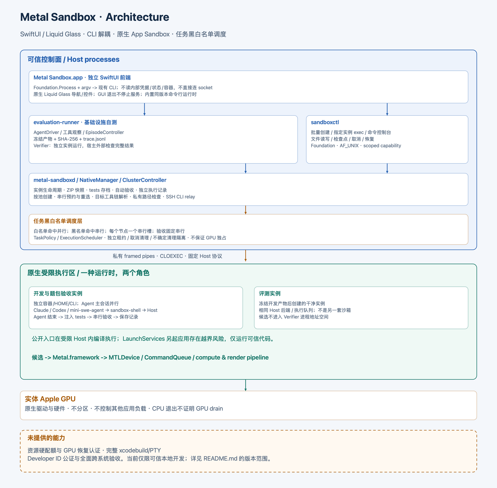

# 架构

创建、Agent 工具调用、并行/串行调度、验收及快照的执行顺序见[完整运行框图](runtime_flow.png)。

题包导入时，`agent/` 进入工作区，`tests/` 按内容 SHA-256 单独存档在后端。启用自动验收后，每次 `exec --session` 保存本次测试版本与超时；Agent 及关联任务结束、清理确认后，在同一实例安装 tests 并通过执行节点的串行队列执行。期间允许读取，阻止其他执行和文件修改。Agent 与验收各自具有执行记录；metrics 按验收执行 ID 存档。主动取消或停止取消后续验收，服务重启续接尚未提交的验收，已经提交的执行不重复启动。

开发与评测使用**同一运行时类型、不同实例和生命周期**。固定测试 AgentDriver 在可信控制面；Agent 主会话、shell 适配器及候选命令由受限 Host 启动；LaunchServices 另起应用存在已报告的越界风险，见安全边界。不要给 Agent 任意宿主 shell 或操作员 token。

## 模块与依赖

| 模块 | 实现位置 | 主要依赖/API |
|---|---|---|
| 桌面前端 | `frontend/sources/frontend_app` | SwiftUI、AppKit；NavigationSplitView、原生 toolbar/sheet、macOS 26+ glassProminent |
| CLI 适配层 | `frontend/sources/frontend_core` | Foundation.Process、参数数组、JSONDecoder；无后端模块依赖 |
| 管理服务与 CLI | `sources/sandbox_daemon`、`sandbox_cli` | Foundation、Darwin；AF_UNIX、getpeereid、DispatchQueue |
| 实例/检查点/发布 | `sources/sandbox_management` | SandboxRuntime；SHA-256、原子 JSON 写入 |
| 自动验收与 tests 存档 | `sources/sandbox_management/native_manager.swift`、`sandbox_runtime/verification.swift`、`task_package.swift` | 既有执行记录、CryptoKit SHA-256、ZIPFoundation、实例操作锁；前端仅调用 CLI |
| 执行调度 | `sources/sandbox_runtime/execution_scheduler.swift`、`task_policy.swift` | 精确路径/参数黑白名单、静态复合 shell 逐条匹配、并行直执行及 FIFO 串行槽、文件锁、独立租约日志 |
| 节点集群 | `sources/sandbox_management/cluster_controller.swift`、`cluster_placement.swift`、`sandbox_runtime/cluster_transport.swift`、`cluster_environment.swift` | SSH 公开 CLI relay、按调度池和活动实例负载分配、节点双向开关、共享工作区、同池串行任务预约与移交、目标工具链解析与私有路径检查 |
| Harness 适配 | `sources/sandbox_runtime/agent_harness.swift`、`claude_harness.swift`、`codex_harness.swift`；`examples/harnesses/mini_swe_agent_metal.py` | Claude 与 Codex：原生适配器、hook、会话日志发现；mini-swe-agent：Python shell 环境 |
| 通用 Shell 桥 | `sources/sandbox_shell`、`sandbox_runtime/shell_bridge.swift` | 原始命令分类、私有 TMPDIR Unix socket、Host pipe、原 cwd/环境执行 |
| Bundle 工厂 | `sources/sandbox_runtime/app_factory.swift` | `/usr/bin/codesign`、Security.framework 签名/entitlement 校验 |
| Host/IPC/文件通道 | `sources/sandbox_host`、`sandbox_runtime` | App Sandbox entitlement、pipe、CLOEXEC、openat、目录 FD |
| 开发目录与工具环境 | `sources/sandbox_runtime/development_policy.swift` | URL security-scoped bookmarks；固定 executable/目录例外；真实工具 PATH/SDKROOT |
| 子进程生命周期 | `sources/sandbox_core/process_runner.swift` | posix_spawn、进程组、waitpid、信号、轮询限制 |
| Agent/Verifier | `sources/evaluation_core`、`evaluation_runner` | AgentDriver、SandboxSession、内容寻址 ArtifactStore |
| GPU 样例 | `sources/metal_runner` | Metal.framework；MTLDevice/CommandQueue/pipeline/buffer/texture |

不依赖容器、VM、独立账号或 Linux；没有 Build Broker/Build Worker。当前通过工具链路径适配在 App Sandbox 内直接编译，控制器只负责解析工具路径与固定签名发布。

创建时可选出站联网：公开 CLI `create`（联网）或 `create --no_network`（断网） → 管理器固定实例配置 → Host 的 `network.client` entitlement。新建默认开启，无运行中切换接口。准备脚本可在自己的 HOME 下载/安装 CLI；`PATH` 加入本实例 `.local/bin`，不添加宿主对应目录。这是通用环境能力，不把 Claude 的安装逻辑放进运行时。

桌面前端打包内置同版本 CLI/runtime，但不链接后端模块。实例列表来自 `list`，详情来自 `inspect`，创建/命令/文件操作分别调用既有 CLI；GPU 排队与权限检查不在前端复制。移除前端仍可独立使用 CLI；退出前端不意味着停止后端。见[图形界面指南](frontend.md)。

## 发布与执行

1. `sandbox exec` 的命令由操作员黑白名单选择并行或 FIFO 串行，同一实例允许并发，只有串行任务互斥；文件操作通过独立的受限文件 API。
2. `clang`/`clang++` 适配为已安装的真实编译器和 SDK；不在宿主机编译候选。
3. Host 为自己的工作区、隔离 HOME、TMPDIR 激活 security scope；编译器生成的测试程序和产物可直接在同一脚本内启动。
4. 开发的逻辑 ID 和物理身份保持不变；普通直接启动的后代继承内核 App Sandbox；不能据此保证 LaunchServices 等其他启动路径同样受限。调度规则覆盖整个任务树，不识别或拦截 GPU 调用，不保证 GPU 独占；Claude hook 为工具输入添加调度标记，但保留原命令与完整 shell 执行脚本；不移除 quarantine。
5. 基础设施自测外壳先冻结产物并停止开发实例，再创建全新校验实例；校验器不加载候选代码到自身地址空间。

状态、恢复与边界见[使用指南](native_operations.md)和[安全文档](security.md)。图形版本见[架构 PNG](architecture.png)。

集群配置与共享目录要求见[节点集群](cluster.md)。管理节点保存实例归属、池配置和任务移交记录；SSH 传输与节点选择分别实现。共享工作区按数据所属节点组织为 `sharedRoot/storageNodeID/instanceID/`，创建时检查本地存储；执行节点通过同路径 SMB 挂载直接访问数据所属节点。跨节点任务要求源节点与目标节点同池、双方允许调度；接收端检查本机限制，等待中的重新选择继续检查当前池。每个物理节点使用独立调度器与隔离状态，远端候选仍由该节点的受限 Host 执行。
